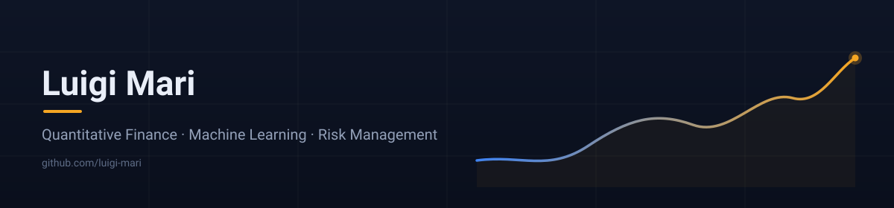
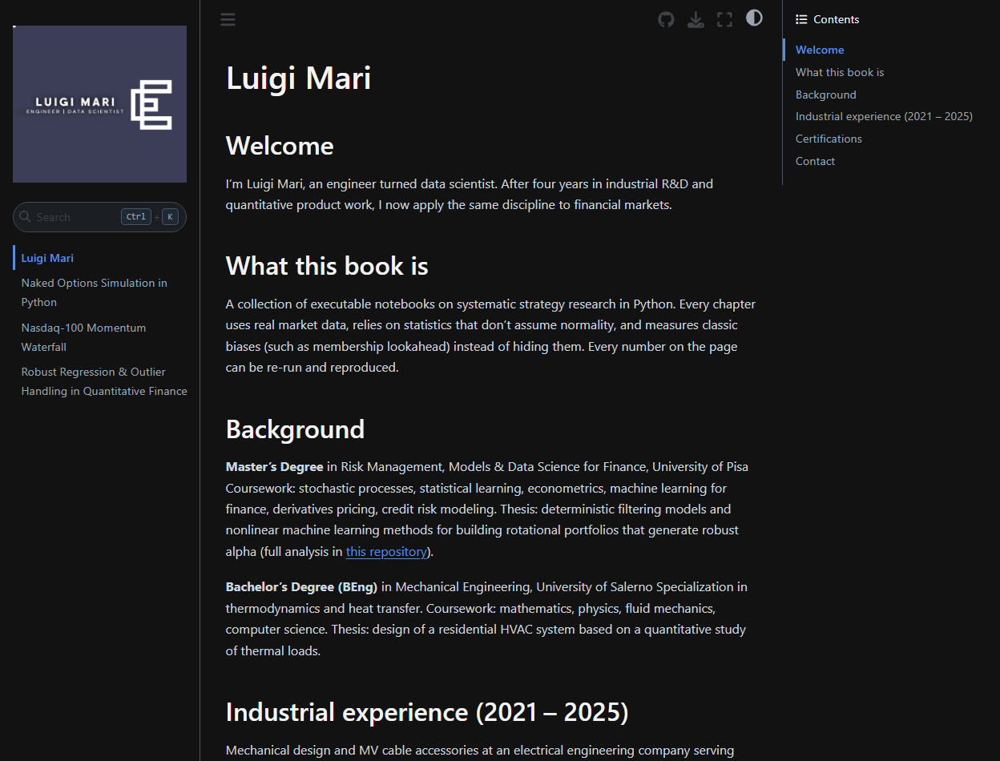
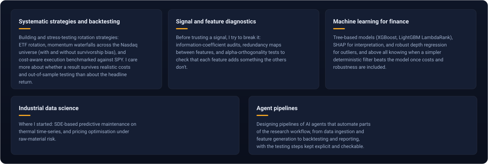

Quantitative finance · machine learning · risk management

## Experience

**Technical Product Manager (QA)** and **R&D Engineer**, electrical engineering company supplying MV products to utilities and private customers worldwide.

## Education

- Master in Risk Management (MRM) · Data Science for Finance · University of Pisa
- B.Eng. · Mechanical Engineering · University of Salerno

## Portfolio

Interactive notebook portfolio, live on GitHub Pages: rotation strategies, signal diagnostics and ML experiments.

## Tech Stack & Skills

  
  
  
  
  
   
  
  
  
   
  
  

## What I'm interested in

